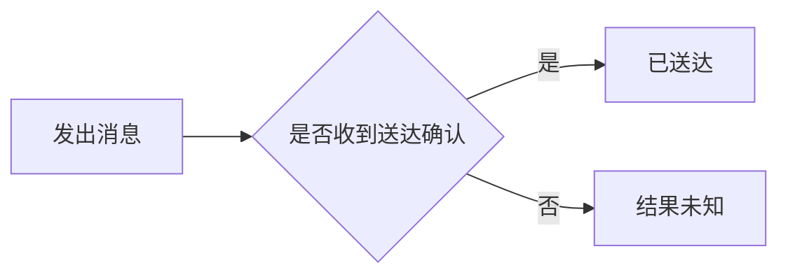

# 图示与交互 HTML 的具体方法

只读当前选择的部分。输入是当前任务提供的事实和关系；缺少关系时标明未知，不自行补设计。

## 图示：输入 → 构图 → 呈现

1. 从已有材料提取对象、连接、条件和结果，保留来源；节点使用读者认识的名称。
2. 按问题选图：步骤/条件用流程图；参与者先后交互用时序图；允许状态变化用状态图；组成用结构图；前后区别用对照图。
3. 当前载体能渲染 Mermaid 时直接使用；需要离线网页或不支持 Mermaid 时制作内嵌 SVG。复杂插图可用宿主绘图工具，但不要把工具不可用当成内容无法交付。
4. 每条连线有明确含义，必要条件标在边上。节点多时按同一问题分层；不通过缩小字体塞满一张图。
5. 实际查看渲染结果，检查遮挡、文字和方向。源码核对与视觉检查分开说明；给一句阅读提示。

合成示例：原材料仅规定“收到确认可判断送达；未收到确认结果未知”，可画为：



该示例不规定重试、超时或补偿，因此图中不增加这些分支。图只是示例信息的表达，不是项目业务规则。

## HTML：场景与步骤讲解器（可直接执行）

本 Skill 提供标准库 Python 工具 `scripts/render_explainer.py`：将明确提供的场景/步骤转为一个离线 HTML，支持场景切换、步骤高亮、上一步/下一步、重置、完整静态内容和打印。无需前端依赖、后端或网络请求。

输入 JSON：

```json
{
  "title": "页面标题",
  "question": "读者要理解的问题与必要前提",
  "sources": ["来源路径/章节，或示例性质说明"],
  "scenarios": [
    {"name": "场景名称", "steps": [
      {"title": "当前步骤", "explanation": "此步骤的已知事实、对应变化及已有原因"}
    ]}
  ]
}
```

这是该工具的数据接口，不是文档通用模板。单段解释不需要填 JSON。工具按输入顺序呈现，不推理业务、不执行真实请求、不计算未知规则。

运行时将下面路径替换为实际 Skill 路径和本任务的新文件路径：

```text
python -X utf8 <skill-dir>/scripts/render_explainer.py <input.json> <new-output.html>
```

输入采用 UTF-8，允许 BOM。输出目录须存在，目标文件已存在则拒绝覆盖，保留用户手工修改；需要重生成时使用新路径并确认差异后替换。参考输入见 [可运行示例](../examples/message-delivery.json)。

执行方法：

1. 明确读者需要比较的场景，整理来源中已有步骤；将重要前提放入 question，关键未知写在对应步骤里。
2. 运行工具生成页面。工具失败时修输入或路径，不补造场景来满足格式。
3. 用浏览器打开实际页面，切换场景、逐步前进、返回和重置；核对展示与输入一致。
4. 检查长文本、窄窗口、键盘操作及完整内容入口。用户需要打印时检查打印结果。
5. 交付 HTML 路径及一句使用说明；同时保留当前任务要求的正式制品和来源关系。

## HTML：需要自定义交互时

涉及连续参数、分支拓扑或计算时，通用步骤工具不够用。围绕任务已定义的规则直接制作一个独立 HTML，内嵌所需 CSS、JS、SVG，不强行转换为步骤表。

先写清“控件改变什么输入 → 哪个已有规则 → 哪处展示变化”。用实际控件演示场景、路径、数值或前后变化；纯折叠、卡片和导航不能替代这类交互。没有公式或边界定义时显示未知，不拟造计算。

优先最小可用页面，不建设账号、后台或产品框架。来源和模拟性质保持可见；外部依赖、资料上传按实际授权。静态解释无需网络服务。

## 验证

- 内容：原事实、条件、未知、数量和范围保留；模拟不是实际执行结果。
- 展示：图可读，页面可打开；所有提供的场景可访问，控制和展示一致；颜色不是唯一提示。
- 降级：浏览器不可用时检查源文件和静态内容，注明未验证交互/视觉效果，不声称预览通过。

工具自身测试入口：`python -X utf8 <skill-dir>/scripts/test_render_explainer.py`。它检查内容保留、HTML/脚本转义、缺失输入和禁止覆盖；不替代实际浏览器检查。
